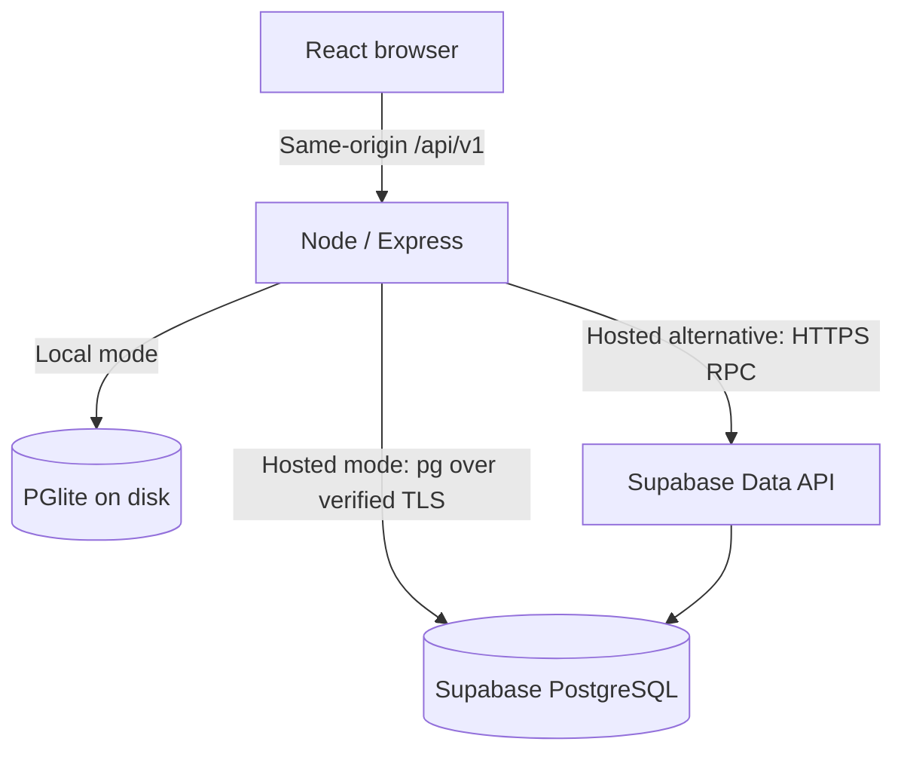

# Architecture

The implemented client is the React web application in `src/`.

The browser calls same-origin JSON endpoints. The Node API validates and normalizes input using Zod, and invokes one database function for each operation. In `DATABASE_MODE=supabase`, when `DATABASE_URL` is configured, a node-postgres pool connects to Supabase over verified TLS through the Session pooler. The pool has at most four connections, a 10-second connection timeout, 10-second statement timeout, and 10-second idle timeout. Each operation uses parameterized arguments and an explicit transaction with `SET LOCAL ROLE service_role`, then commits or rolls back before returning its connection. Failed rollback discards the connection. The hosted PostgreSQL adapter runs parking queries as `service_role`; this role switch does not apply to local PGlite.

In hosted mode, when `DATABASE_URL` is empty, the optional HTTP adapter invokes the same functions using a server-only Supabase API key. The frontend receives neither database passwords nor server keys. PGlite calls the same functions through parameterized SQL. App-level arrays of slots/records support zone filtering, counting and rendering without making browser state authoritative.

## Persistent model

`cpvts_slots` defines immutable-by-application capacity and ordered space IDs. `cpvts_records` contains all parking sessions. Occupancy is derived from records with null exit hours, avoiding a redundant availability flag that could diverge from records. Partial unique indexes allow at most one active session per vehicle and per slot. Composite foreign keys require the record's vehicle type to match the slot's zone. Hour and receipt completeness checks protect the data model.

`cpvts_reservations` stores one reservation per slot, with a vehicle number, note and timestamp. Allocation excludes reserved slots. Snapshot status gives `Reserved` precedence over `Occupied`, while retaining any active record. Reservation replacement is rejected until the existing reservation is released. The current reservation function does not reject occupied slots, so a reservation and active session can coexist; releasing that reservation does not check out the vehicle.

Initialization inserts only missing default slots. The migration never truncates or clears a session. The local database is written under `LOCAL_DATA_DIR`, default `data/parking`; the directory must be retained for persistence. It is never placed in browser storage. A local process owns this embedded database; use Supabase for multi-instance hosting.

## Transactions and concurrency

Check-in, check-out and reservation creation acquire an `EXCLUSIVE` table lock on the slot table, serializing these operations across Node instances using Supabase while allowing ordinary reads. Reservation release deletes its reservation row without explicitly acquiring that same slot-table lock; the shared-lock guarantee therefore does not cover every mutation. A check-in normalizes/validates the vehicle, checks duplicates, selects the lowest ordinal free slot and inserts the record in one transaction. A check-out locks the record, validates the exit hour, calculates the fee, and stores the receipt in the same transaction that makes the slot available. Failed statements roll back. The unique indexes provide an additional integrity barrier for active sessions. They do not prevent an occupied slot from also having a reservation.

This deliberately simple lock is suitable for 15 campus spaces. It prioritizes exact first-available semantics over throughput. All application mutations must use these functions. Administrative SQL can bypass business logic and is outside the public API contract.

## Fee and reporting authority

Fee rules live in the checkout database function. Staff are free; students get up to two free hours then ₹10/₹20 per hour; visitors pay ₹20/₹40 per hour for two/four-wheelers respectively. Duration is exit minus entry with no overnight rollover. The receipt stores free hours, billable hours and the applied rate so it remains auditable.

The snapshot function produces a consistent statement-level view. Its records include all active sessions plus sessions entering or leaving on the reporting date. Daily totals use timestamps converted to `Asia/Kolkata`. Zone `occupied` counts active sessions; `vacant` is total minus occupied and includes unoccupied reserved slots. Count slots whose status is `Available` for allocatable capacity. Dashboard reads poll every 15 seconds and refresh after mutations. An unavailable connection shows a warning; cached figures are last-known state, not asserted current occupancy. Mutations never fall back to mock data. Receipt amounts are assessed fees, not payment confirmations.

## Trust boundary

Operator authentication is not implemented. The app binds to loopback by default and is intended for local/trusted campus use. For POST requests carrying an `Origin` header, the API rejects a malformed origin or one whose host differs from the request host. The explicit check does not cover DELETE reservation requests or requests without an Origin header. CORS is not enabled. This is not authentication; clients with direct API access can operate parking. A public deployment requires a separately chosen operator access policy. TLS and an authenticated reverse proxy can be added by the operator if needed.

Supabase tables enable RLS without anonymous policies. Parking functions use `SECURITY INVOKER` with an empty search path and schema-qualified objects. Function execution and table grants are removed from `PUBLIC`, `anon` and `authenticated`; the service role is the only intended hosted caller. Server errors are mapped to stable API errors without returning database credentials or raw schema details. Payload size and external request time are bounded. There is no automatic retry of mutations after an ambiguous network failure: users are told to refresh before retrying.
